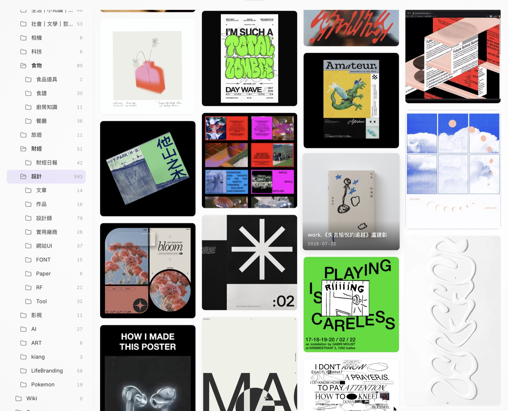
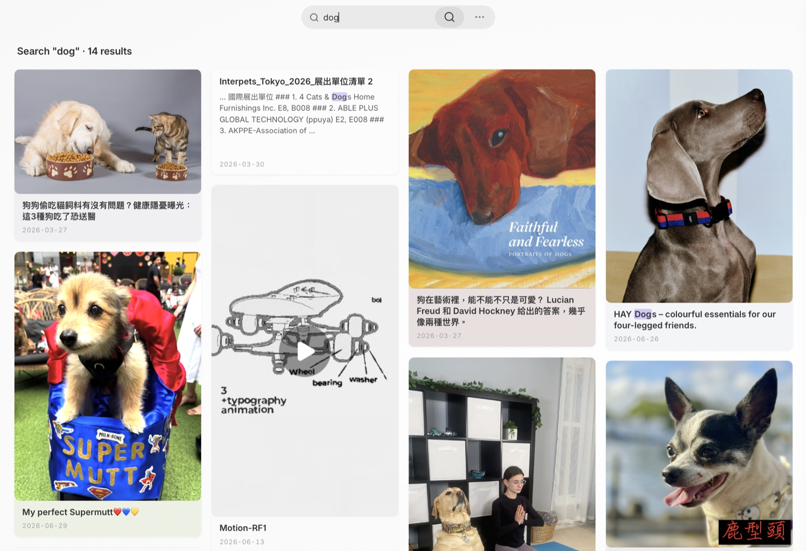
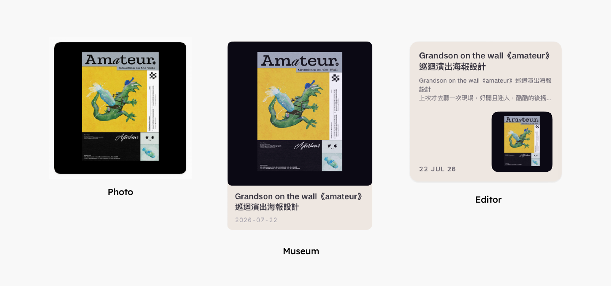

# Gallery Navigator

**[English](README.md) | 简体中文**

浏览 Obsidian 库（vault）的一种可视化方式：左侧是文件夹／标签树，右侧是**由封面图片组成的瀑布流卡片墙**。它专为替代列表式文件管理器而生。

界面支持**英文**、**繁體中文**与**简体中文**（跟随 Obsidian 的界面语言设置，也可在插件设置里手动指定）。

## 截图



| 卡片墙 | 标签树 | 搜索 |
|---|---|---|
|  |  |  |

> [!TIP]
> 这些截图使用了 [**Velocity**](https://github.com/gonzalo-d-sales/obsidian-velocity) 主题——想让你的卡片墙有上图的效果，它是好搭配。插件从 Obsidian 的 CSS 变量取色，所以跟随任何主题，深浅色模式都适配。

## 功能

### 卡片墙
- 纯 JS 真瀑布流布局，懒加载 + 分块渲染（上千文件的文件夹也从容，移动端友好）
- 封面取自：`cover:` frontmatter、笔记首个嵌入图片、图片文件自身、PDF 首页，以及链接笔记对应网页的 `og:image`
- 卡片可置顶、可逐卡设置底色；多选支持批量移动／删除（可选连同未被其他笔记引用的附件一并删除）／复制 Wiki 链接
- Canvas 与 Base 文件同样渲染为卡片（Canvas 有嵌入图片时，取第一张作封面）

### 图片卡版面

三种版面，随时可在工具列的「**⋯ 更多**」面板切换——它们改变标题与日期相对封面图的摆法：



- **Photo** —— 标题直接叠在图片上，整个文件夹看起来就是一整面照片墙。适合「图片本身就是内容」的图库型集合。
- **Museum** —— 图在上、说明在下，像展品旁的标示牌。适合既想封面不被裁切、又要一眼看清标题的场景。
- **Editor** —— 小缩图搭配大号日期与文字摘录。适合以文字为主的浏览：笔记本身比它的封面更重要。

### 导航
- 文件夹树支持拖拽排序、自定义颜色、隐藏／取消隐藏、收藏与就地重命名
- 移动端排序：长按文件夹 → 选「**调整顺序**」，拖动每行右侧的把手即可排序。顺序与桌面端是同一份数据，跨装置跟着你走
- 在文件夹面板的空白处右键，即可新建顶层文件夹
- 多选文件夹批量移动——`Cmd`／`Ctrl` 点击逐个加选，`Shift` 点击区间连选，移动端用长按菜单里的「**多选**」。拖动任意一个已选中的文件夹即可整批移动
- 重命名或移动文件夹后，它在树中的位置保持不变，颜色、图标、隐藏状态、收藏与版面设置也一并跟着走
- 仿 Bear 的嵌套标签树，带「未标签」节点
- 跟随模式：打开笔记时，自动在树与卡片墙中定位到它
- 移动端：双栏并排，跟手滑动手势即可左右切换
- 多设备友好：共享设置（文件夹顺序、颜色、图标、置顶、收藏……）会与其他装置的写入做**合并**而非覆盖，不必重启 Obsidian 即可生效；各装置自己的浏览状态（当前文件夹、展开节点、面板宽度、卡片大小）留在本机、不随同步流动

### 全文搜索
- 内置 BM25 索引，覆盖所有笔记**与 PDF**（中文分词 + 二元组回退）
- 仿 Spotlight 的悬浮搜索窗（可绑定快捷键），带缩略图、命中高亮与上下文摘要
- `Shift+Enter` 把全部结果送进卡片墙
- PDF 正文优先读取 [Text Extractor](https://github.com/scambier/obsidian-text-extractor) 插件的缓存（可选依赖——不装它也照常支持文件名搜索）

### 附加模块（可分别关闭）
- **图片预览（Image peek）**：仿 Quick Look 的图片预览，带分享／复制操作
- **链接卡片（Link cards）**：独占一行的裸网址渲染成图文预览卡片
- **链接净化（Clean links）**：移除网址中的跟踪参数（`utm_*`、`xmt`、`slof`、`fbclid`、`igsh`、`gclid`……）——粘贴时自动净化、编辑器右键菜单（单条链接、选区或整篇笔记）、右键链接卡片皆可调用。基于黑名单实现，YouTube `?v=` 这类功能参数绝不误伤；额外删除／永久保留清单均可自定义。参数删减完全离线。Threads／Instagram 的 `/share/` 短链把跟踪码藏在路径里，还原真实帖子链接需发起一次网络请求（默认开启，可关闭，见下文）。

## 联网行为说明

本插件只在下列功能中发起网络请求。不收集、不跟踪、不向任何其他地址发送数据；没有遥测。

| 功能 | 发送内容 | 发往何处 |
|---|---|---|
| 链接预览／链接卡片 | 对笔记中出现的 URL 发起 GET 请求，读取其 `og:image`／元数据 | 你的笔记所链接的网站 |
| 链接卡片上的站点图标 | 每个被链接网站的域名 | Google 图标服务（`www.google.com/s2/favicons`） |
| Instagram 帖子的链接卡片 | 正在预览的帖子 URL，用于读取作者名与帖子文字 | Instagram 的 oEmbed 端点（`instagram.com`） |
| 链接净化——短链还原（默认开启，可关闭） | 对正在还原的 `threads.com/share/…` 或 `instagram.com/share/…` 链接发起一次 GET 请求，读取其 `canonical` URL | Threads／Instagram |

**关于 User-Agent 请求头。** 元数据请求会带上常见浏览器或链接预览机器人（`facebookexternalhit`、`Slackbot-LinkExpanding`）的 User-Agent，按顺序尝试直到取到可用元数据。有些站点对默认 UA 返回 `403`、却肯给链接预览机器人吐出 `og:` 标签——不带这个 UA，多数卡片都会是空的。这与 Slack、iMessage 等聊天软件渲染链接预览用的是同一套机制，读取的仅限公开元数据——不涉及登录、凭据或任何用户数据。

所有缓存（链接预览、PDF 缩略图）都存放在插件目录的本地。

## 插件会访问什么

| 能力 | 用途 |
|---|---|
| **列举库文件**（`getFiles`、`getMarkdownFiles`） | 卡片墙与文件夹／标签树都基于文件列表构建——插件必须知道库里有哪些文件才能显示它们。不外发任何数据，列表只留在内存中。 |
| **读取文件**（`cachedRead`） | 用于解析笔记的封面图、渲染卡片上的文字摘录、以及建立搜索索引。 |
| **写入文件**（`create`、`modify`、`rename`、`delete`） | 只响应你的明确操作：新建笔记、重命名、移动、批量删除，以及「把 Canvas 图片转成笔记」命令。 |
| **剪贴板** | 只用于你主动触发的复制动作——复制图片、复制所选卡片的 Wiki 链接、净化粘贴进来的网址。 |
| **`localStorage`** | 只读取 Obsidian 自己的 `language` 键以跟随界面语言。各装置的浏览状态（当前文件夹、展开节点、面板宽度、卡片大小……）通过 Obsidian 的库级 `App.saveLocalStorage` API 存储，因此留在本机、不随同步流动；在没有该 API 的旧版 Obsidian 上回退到 `data.json`。其余一切数据都通过 Obsidian 的插件数据 API（`data.json`）存储。 |

## 安装

在本插件上架社区商店之前，请手动安装：

1. 从最新 [release](https://github.com/groundfic/obsidian-gallery-navigator/releases) 下载 `main.js`、`manifest.json` 与 `styles.css`
2. 拷贝到 `<你的库>/.obsidian/plugins/gallery-navigator/`
3. 在 设置 → 第三方插件 中启用 **Gallery Navigator**

也可以用 [BRAT](https://github.com/TfTHacker/obsidian42-brat) 添加本仓库。

> [!IMPORTANT]
> **从 Image Peek 或 Link Card Preview 迁移过来？请先停用它们。**
>
> 我早先的两个独立插件，现已作为 **图片预览（Image peek）** 与 **链接卡片（Link cards）** 模块内置进 Gallery Navigator。让它们与本插件同时运行，等于同一份工作做两遍：两套文档监听器、同一个 URL 渲染两张卡片、同一份下载存两套缓存。
>
> 旧插件的设置与缓存**不会**继承——链接预览首次使用时会重新抓取。你也可以继续用独立版本，只把本插件对应的模块关掉（设置 → Gallery Navigator → *图片预览*／*链接卡片*）。

## 开发

```bash
npm install
npm run dev        # CSS 先构建一次，然后 esbuild 监听 JS
npm run dev:css    # 只监听 CSS 分片（调样式时好用）
npm run build      # 生产打包 → main.js + styles.css
```

源码在 `src/`。**根目录的 `main.js` 与 `styles.css` 都是构建产物——不要直接改它们。**

- **JS** —— 入口是 `src/main.js`，由 esbuild 打包。
- **CSS** —— Obsidian 只加载一个 `styles.css`，但把 3000 行塞在一个文件里没法维护，所以由 `scripts/build-css.mjs` 分片拼装：

  | 分片 | 作用域 |
  |---|---|
  | `src/header.css` | 文件头注释 |
  | `src/gallery.css` | `.gn-*` —— 树、卡片墙、工具列 |
  | `src/peek.css` | `.qp-*` —— 图片预览 |
  | `src/linkcard.css` | `.lcp-*` —— 链接卡片 |

  顺序很重要（后面的分片可以覆盖前面的）。若花括号不配平，构建会拒绝写出 `styles.css`——某一分片被截断时会响亮报错，而不是悄悄把样式表弄坏。

- **界面文案** —— `src/i18n.js`：英文原文即 key，配有 zh-TW 与 zh-CN 两份字典。

### 发布

```bash
npm run release 0.2.1      # 同步 bump manifest/package/versions，构建、提交、打 tag
git push origin main && git push origin 0.2.1
```

推送 tag 会触发 `.github/workflows/release.yml`：从源码重新构建、校验 tag 与 `manifest.json` 一致、附上[构建来源证明](https://docs.github.com/actions/security-guides/using-artifact-attestations)，并创建 release。不要手动跑 `gh release create`——那样上传的资产无法出具证明。

版本号存于三个文件（`manifest.json`、`package.json`、`versions.json`），发布脚本负责保持一致。`versions.json` 把每个插件版本映射到它的最低 Obsidian 版本，旧版 Obsidian 的用户因此总能解析到兼容的发布。

**绝不要给已发布的版本重新打 tag。** Obsidian 靠比较版本号判断有没有更新，悄悄替换既有 release 的资产，已安装的用户永远收不到修复。请发新的补丁版本号。

## 许可

[MIT](LICENSE)
